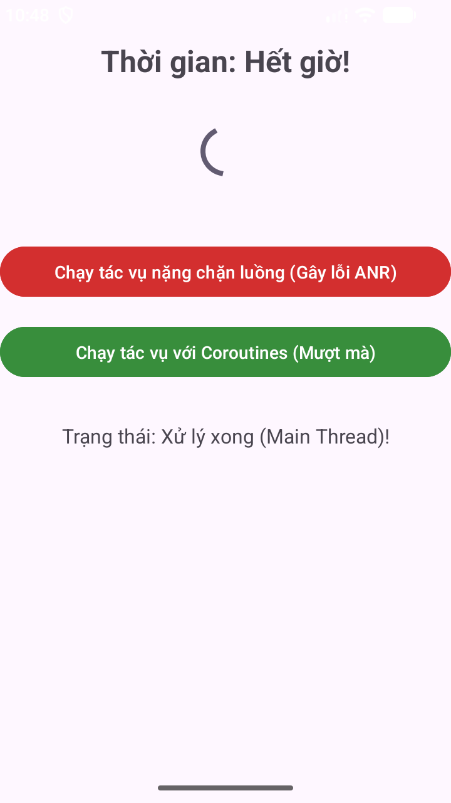
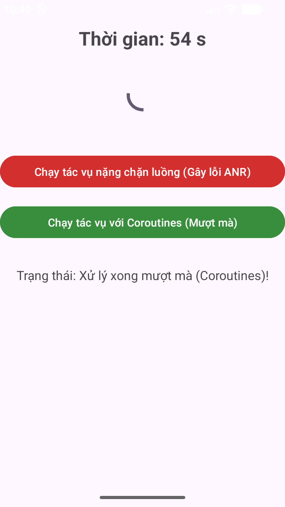
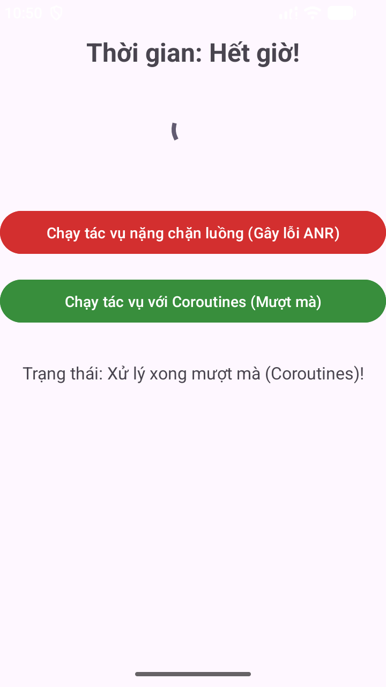

# Lab 3 - Kotlin Coroutines

## 1. Mục tiêu
- Tìm hiểu Main Thread và Background Thread.
- Sử dụng Kotlin Coroutine.
- Thực hành lifecycleScope và withContext.
- Sử dụng ViewBinding và ConstraintLayout.

## 2. Chức năng
- Đếm ngược 30 giây.
- Button 1: Chạy tác vụ trên Main Thread làm giao diện bị đơ.
- Button 2: Chạy tác vụ nền bằng Dispatchers.Default.

## 3. Công nghệ
- Kotlin
- Android Studio
- ConstraintLayout
- ViewBinding
- Kotlin Coroutines

## 4. Hình ảnh minh chứng

### Button 1 - Main Thread bị đơ

### Button 2 - Chạy nền mượt mà

### Countdown

